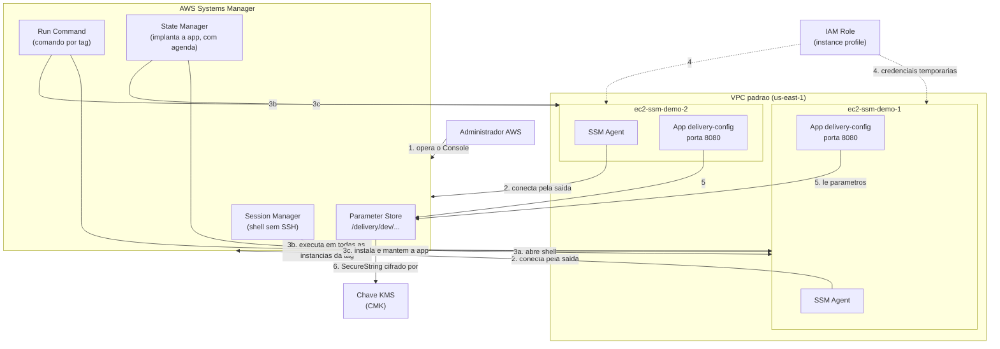

# Arquitetura — AWS Systems Manager e Parameter Store: acesso sem SSH, automação e segredo

## Resumo

Neste laboratório, **um administrador** usa o **AWS Systems Manager** para gerenciar **duas máquinas EC2** sem abrir SSH e sem expor nenhuma porta. Pelo Systems Manager você:

1. **entra** na máquina (Session Manager);
2. **manda comandos** para uma ou várias máquinas (Run Command);
3. **guarda configuração e segredos** (Parameter Store), com a senha cifrada por uma chave KMS sua;
4. **implanta e mantém uma aplicação** nas duas máquinas (State Manager), que lê essa configuração.

A ideia de segurança que costura tudo: **nenhuma chave SSH, nenhuma porta de entrada, nenhuma credencial fixa**. A máquina "puxa" tudo pela saída, com credenciais temporárias.

| Parte do lab | O que você aprende | Serviço principal |
|--------------|--------------------|-------------------|
| 1 | Acessar a EC2 sem SSH e sem porta 22 | Session Manager |
| 2 | Executar comandos remotos sem abrir sessão | Run Command |
| 3 (principal) | Guardar configuração e segredos com criptografia e versões | Parameter Store + KMS |
| 4 | Automatizar e manter uma aplicação em várias máquinas | Run Command por tag + State Manager |

.png)

## Diagrama

.png)

## Como funciona, passo a passo

1. **Você opera o Console** do Systems Manager.
2. **O SSM Agent** de cada EC2 abre uma conexão de **saída** até o Systems Manager. É isso que torna a instância "gerenciada" (aparece como *Online*). Não há conexão de entrada.
3. **O Systems Manager age sobre as máquinas** por esse canal:
   - **Session Manager:** abre um terminal no navegador.
   - **Run Command:** roda o mesmo comando em todas as instâncias com a tag `Ambiente=ssm-demo`.
   - **State Manager:** instala a aplicação nas duas e a reaplica na agenda, corrigindo desvios.
4. **A EC2 recebe credenciais temporárias** da função IAM (via *instance profile*). Nada de chave de acesso gravada na máquina.
5. **A aplicação lê a configuração** do Parameter Store, em `/delivery/dev/...`, usando essas credenciais.
6. **O `SecureString` (a senha) só vem em claro** se duas permissões existirem ao mesmo tempo: `ssm:GetParameter...` no parâmetro **e** `kms:Decrypt` na chave. Se faltar uma, o resultado é `AccessDenied`.

> A aplicação **nunca mostra a senha**. Ela só informa se foi carregada e o tamanho.

## Componentes

| Componente | Para que serve | Como está no laboratório |
|------------|----------------|--------------------------|
| **Systems Manager** | Reúne Session Manager, Run Command, State Manager e Parameter Store | Acesso e automação sem SSH |
| **SSM Agent** | Conecta a EC2 ao Systems Manager | Já vem no Amazon Linux 2023; precisa de saída para a internet |
| **2 × EC2 Linux** | Máquinas gerenciadas | `ec2-ssm-demo-1` e `-2`, `t3.micro`, **sem par de chaves**, tag `Ambiente=ssm-demo` |
| **Security group** | Firewall da EC2 | `sg-ssm-demo`, **sem regras de entrada** |
| **Função IAM + instance profile** | Dá credenciais temporárias à EC2 | `role-ssm-demo-ec2` com `AmazonSSMManagedInstanceCore` e leitura de `/delivery/dev/*` |
| **VPC padrão** | Rede da EC2 | Tem Internet Gateway, que dá a saída para o SSM (alternativa: VPC endpoints) |
| **Parameter Store** | Guarda configuração e segredos com hierarquia e versões | Camada Padrão (sem custo): `String`, `StringList` e `SecureString` |
| **Chave KMS (CMK)** | Cifra o `SecureString` | `alias/delivery-dev-securestring`, custa cerca de USD 1.00/mês |
| **Aplicação `delivery-config`** | Mostra a identidade da máquina e a configuração lida | Python, porta `8080`, serviço `systemd`, código em `app/deploy-app.sh` |

### Os parâmetros do laboratório

| Parâmetro | Tipo | Em claro? |
|-----------|------|-----------|
| `/delivery/dev/ambiente` | `String` | Sim |
| `/delivery/dev/database/host` | `String` | Sim |
| `/delivery/dev/database/usuario` | `String` | Sim |
| `/delivery/dev/notificacoes` | `StringList` | Sim |
| `/delivery/dev/database/senha` | `SecureString` (CMK) | **Não**, só com `kms:Decrypt` |

Cada alteração de valor cria uma nova **versão** (+1), e as anteriores ficam no histórico. A leitura sem informar versão devolve a atual.

## Por que essas decisões de segurança

| Decisão | Motivo |
|---------|--------|
| **Session Manager em vez de SSH** | Sem chave e sem porta 22 aberta, há menos superfície de ataque. O acesso é controlado por IAM (`ssm:StartSession`) e pode ser auditado em logs de sessão. |
| **Instance profile em vez de chave de acesso** | As credenciais são temporárias e renovadas sozinhas. Se vazarem, expiram. |
| **Menor privilégio** | A função lê só `/delivery/dev/*` e usa só a CMK do laboratório. Nenhuma ação com curinga `*`. |
| **CMK em vez da chave `aws/ssm`** | Você controla a política e a auditoria da chave, e ganha uma camada extra de autorização (`kms:Decrypt`). |
| **Sem entrada na rede** | A aplicação é testada pelo Run Command, dentro da máquina. O acesso por navegador (porta 8080, só o seu IP) é opcional e temporário. |
| **Configuração fora do código** | Alterar um parâmetro muda o comportamento da aplicação sem reimplantar. |

## Duas comparações importantes

### Chave KMS da AWS (`aws/ssm`) × chave KMS sua (CMK)

| | `aws/ssm` (gerenciada pela AWS) | CMK (sua) |
|---|---|---|
| Controle | AWS | Você (política, rotação, auditoria) |
| Custo | Sem custo de chave | Mensal por chave |
| Quando usar | `SecureString` simples | Controle ou conformidade próprios. **É a usada neste lab.** |

### Política da identidade × política da chave

Para ler o `SecureString` em claro, **as duas** precisam permitir. Uma não substitui a outra.

| | Política de identidade (na função IAM) | Política da chave (na CMK) |
|---|---|---|
| Responde | O que a função **pode pedir** | Quem **pode usar a chave** |
| No laboratório | Libera `ssm:Get*` em `/delivery/dev/*` e `kms:Decrypt` na CMK | Libera `kms:Decrypt` à função `role-ssm-demo-ec2` |

### Parameter Store × Secrets Manager

| | Parameter Store (Padrão) | Secrets Manager |
|---|---|---|
| Rotação automática de credenciais | Não | **Sim** |
| Custo | Sem custo por parâmetro | Por segredo + chamadas |
| Use quando | Configuração e segredos simples | Credenciais que precisam girar sozinhas |

Atualizar um parâmetro **não** troca a senha no banco real. Para rotação de verdade, use o Secrets Manager.

## Glossário rápido

| Termo | Em uma frase |
|-------|--------------|
| **Instância gerenciada** | EC2 com SSM Agent funcionando, que aparece *Online* no Systems Manager |
| **Instance profile** | "Crachá" que entrega a função IAM à EC2 |
| **CMK** | Chave KMS criada e controlada por você |
| **Tag** | Rótulo `chave=valor` usado aqui para escolher quais máquinas recebem a automação |
| **Associação (State Manager)** | Regra que aplica um script nas máquinas da tag, na agenda, e corrige desvios |
| **Documento SSM** | "Receita" executada pelo Systems Manager, como `AWS-RunShellScript` |
