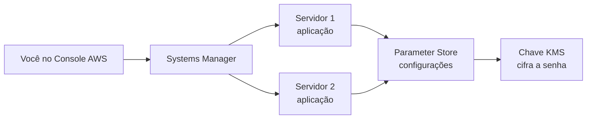

# AWS Systems Manager e Parameter Store: acesso sem SSH, automação e segredo

Quando você cria um servidor na nuvem, as primeiras perguntas costumam ser: como eu entro nele? Onde guardo a senha do banco? Como faço a mesma mudança em dez máquinas sem repetir tudo dez vezes?

Muita gente responde com chave SSH, porta 22 aberta e senha escrita dentro do código. Funciona, mas cada um desses atalhos é uma porta de entrada para problemas. Neste artigo eu mostro como resolver as três perguntas com **um único serviço da AWS**, o **Systems Manager**, sem abrir nenhuma porta e sem guardar nenhuma senha no código.

.png)

## O problema com o jeito tradicional

- **Chave SSH:** precisa ser guardada, compartilhada e trocada quando alguém sai do time.
- **Porta 22 aberta:** qualquer pessoa na internet pode tentar entrar.
- **Senha no código:** quem tem acesso ao repositório tem acesso ao banco.
- **Servidor por servidor:** cada mudança manual é uma chance de esquecer uma máquina.

## A ideia

Em vez de **você** chegar até o servidor, o servidor **liga para a AWS**. Um pequeno programa instalado nele (o SSM Agent) abre uma conexão de saída com o Systems Manager. Por esse canal você consegue abrir um terminal, mandar comandos e distribuir configuração. Como a conexão sempre parte do servidor, **não existe porta de entrada para atacar**.

## O que foi construído

Duas máquinas Linux (EC2), uma aplicação simples rodando nas duas, e toda a configuração dessa aplicação guardada na AWS. A senha do banco fica cifrada por uma chave que é só sua.

.png)

## Parte 1: entrar no servidor sem SSH

O **Session Manager** abre um terminal direto no navegador. Você não usa chave, e o servidor não tem nenhuma porta de entrada aberta. Quem pode abrir sessões é controlado por permissões (IAM), e é possível registrar tudo o que foi digitado.

O teste que prova a ideia: o firewall da máquina está **sem nenhuma regra de entrada** e, mesmo assim, o terminal funciona.

## Parte 2: mandar comandos sem entrar

O **Run Command** executa um comando em uma ou várias máquinas e mostra o resultado na tela. Não há sessão aberta, e fica um histórico de quem executou o quê, onde e com qual resultado. É ideal para tarefas de rotina, como verificar disco, memória ou versão do sistema.

.png)

## Parte 3: guardar configuração e segredos

O **Parameter Store** funciona como um cofre organizado em pastas, por exemplo `/delivery/dev/database/usuario`. Ele guarda três tipos de valor:

| Tipo | Para que serve | Aparece em texto claro? |
|------|----------------|-------------------------|
| `String` | Um valor simples, como o nome do ambiente | Sim |
| `StringList` | Uma lista, como e-mails de aviso | Sim |
| `SecureString` | Segredos, como a senha do banco | **Não**, fica cifrado |

Para o segredo, usamos uma **chave do KMS** criada por nós. Isso cria duas travas: para ler a senha, a máquina precisa de permissão no Parameter Store **e** de permissão na chave. Se faltar qualquer uma, o acesso é negado.

Bônus: cada alteração cria uma **nova versão** e as anteriores ficam no histórico, então dá para ver o que mudou.

.png)

.png)

## Parte 4: automatizar as duas máquinas

Aqui a história fica interessante. Em vez de escolher máquina por máquina, damos a elas uma **etiqueta** (tag), por exemplo `Ambiente=ssm-demo`, e mandamos o Systems Manager agir em tudo que tiver essa etiqueta.

Três coisas que valem ver funcionando:

1. **Mesmo comando nas duas máquinas de uma vez.** É possível limitar quantas rodam ao mesmo tempo e parar tudo se algo der errado, o que evita espalhar um erro por toda a frota.
2. **Instalar uma aplicação em todas.** O **State Manager** instala e mantém a aplicação nas duas máquinas. Ela lê a configuração do Parameter Store e **nunca mostra a senha**, só informa que a carregou.
3. **Corrigir sozinho o que foi quebrado.** Se alguém para a aplicação e apaga o código em uma máquina, basta reaplicar a regra do State Manager e tudo volta ao lugar.

E um detalhe prático: ao mudar o valor de `ambiente` para `producao` no Parameter Store, as duas aplicações passam a mostrar o novo valor em segundos, **sem reinstalar nada**. A configuração fica fora do código.

.png)

.png)

## Regras de segurança que ficam de lição

- **Sem chave SSH e sem porta de entrada.** A máquina sempre fala primeiro.
- **Sem senha ou chave de acesso gravada na máquina.** Ela recebe credenciais temporárias, que expiram sozinhas.
- **Permissão só do necessário.** A máquina lê apenas a pasta de parâmetros da aplicação.
- **Segredos cifrados com uma chave que você controla.**
- **Configuração fora do código.** Muda o valor, muda o comportamento, sem novo deploy.

## Parameter Store ou Secrets Manager?

| | Parameter Store | Secrets Manager |
|---|---|---|
| Troca automática de senha | Não | **Sim** |
| Custo | Sem custo por parâmetro | Cobrado por segredo |
| Quando usar | Configuração e segredos simples | Credenciais que precisam girar sozinhas |

Atenção a um ponto comum de confusão: **atualizar** um parâmetro só troca o valor guardado. Ele não troca a senha no banco de dados de verdade.

## Quanto custa

Para um teste de poucas horas, pouco. Valores aproximados na região N. Virgínia (`us-east-1`):

- **2 máquinas `t3.micro`:** cerca de USD 0.02 por hora no total.
- **Chave KMS:** USD 1.00 por mês, cobrada enquanto existir.
- **Systems Manager e Parameter Store (camada padrão):** sem custo adicional.

O que mais pesa é esquecer recursos ligados. Por isso o passo a passo termina com a **limpeza**, que exclui tudo na ordem certa.

## Como reproduzir

Tudo é feito pelo Console da AWS, em português, sem instalar nada no seu computador. Você só precisa de uma conta AWS e das permissões para criar EC2, IAM, KMS e Systems Manager. Nenhum outro laboratório é necessário.

| Arquivo | O que tem |
|---------|-----------|
| [`IMPLANTACAO.md`](IMPLANTACAO.md) | O passo a passo completo: onde clicar, o que preencher, o resultado esperado e a limpeza |
| [`ARQUITETURA.md`](ARQUITETURA.md) | A arquitetura explicada com diagrama, componentes e decisões de segurança |
| [`app/deploy-app.sh`](app/deploy-app.sh) | O código da aplicação. Na Parte 4, copie o conteúdo inteiro e cole no campo de comandos do State Manager |

Todos os valores de exemplo (usuário, senha, host) são **fictícios**. Nunca use credenciais reais.

## Conclusão

O Systems Manager troca um monte de atalhos arriscados por um só caminho seguro e auditável. Você entra nas máquinas sem SSH, executa tarefas em lote, guarda configuração e segredos com criptografia e mantém uma aplicação sempre no estado esperado. Tudo isso reduzindo a superfície de ataque, em vez de aumentá-la.

Se você já usa SSH e senhas em arquivos de configuração, este é um bom primeiro passo para mudar.

.png)
